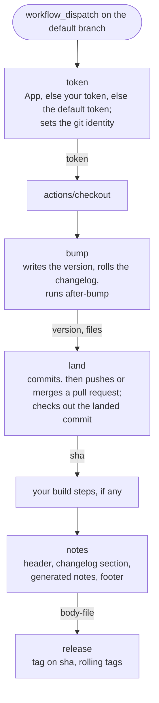
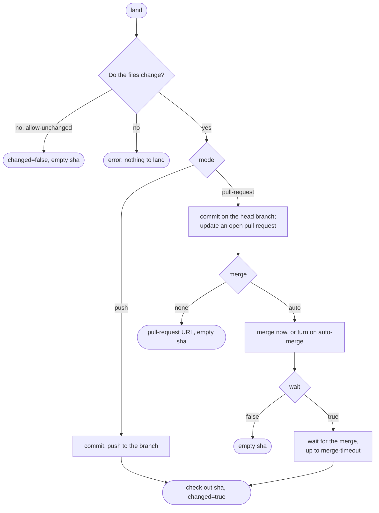

# Release Actions

Five composite GitHub Actions that release a repository from its changelog.

- `token` picks the token of the workflow: a GitHub App token, a token that you give, or the default token.
  It also sets the git identity that matches this token.
- `bump` writes the next version to your files and turns the `## Unreleased` section of `CHANGELOG.md` into the section of the new version.
- `notes` makes the release body from a header template, that changelog section, and the notes that GitHub generates.
- `land` commits the bump and lands it on the branch, with a push or with a pull request that it merges.
- `release` creates the GitHub release and, on request, moves the rolling `vX` and `vX.Y` tags.

## Release flow

A release job uses the actions in this order.
The labels show the outputs that the next steps read.
The `sha` output of `land` is the target of `notes` and `release`.



The actions stop a release that is not safe, so a workflow does not need its own checks for these cases:

- `land` stops a release that runs on a branch other than the default branch.
- `bump` stops when the files hold a version that a failed run bumped but did not release.
- `token` with `require-app: true` stops when no GitHub App is set.

## Requirements

The actions run on the GitHub-hosted Ubuntu and macOS runners.
These runners have bash, perl, `yq` v4 and `gh`.
On other runners, install `yq` v4 and `gh` before the first step.
`bump`, `release`, and `notes` with `generate-notes: true` call the GitHub API, so the job needs `contents: read` at least.

## Example

```yaml
- name: Get the token
  id: token
  uses: mcanouil/release-actions/token@v1
  with:
    app-id: ${{ vars.APP_ID }}
    app-key: ${{ secrets.APP_KEY }}

- name: Check out the repository
  uses: actions/checkout@v7
  with:
    fetch-depth: 0
    token: ${{ steps.token.outputs.token }}

- name: Bump the version
  id: bump
  uses: mcanouil/release-actions/bump@v1
  with:
    bump: minor
    token: ${{ steps.token.outputs.token }}
    targets: |
      - file: CITATION.cff
        pattern: '^version: {version}$'
      - file: CITATION.cff
        pattern: '^date-released: "{date}"$'
      - file: package.json
        pattern: '^  "version": "{version}",$'

- name: Land the bump
  id: land
  uses: mcanouil/release-actions/land@v1
  with:
    mode: push
    files: ${{ steps.bump.outputs.files }}
    version: ${{ steps.bump.outputs.version }}
    token: ${{ steps.token.outputs.token }}

- name: Make the release body
  id: notes
  uses: mcanouil/release-actions/notes@v1
  with:
    notes-file: ${{ steps.bump.outputs.notes-file }}
    version: ${{ steps.bump.outputs.version }}
    tag: ${{ steps.bump.outputs.version }}
    target: ${{ steps.land.outputs.sha }}
    generate-notes: true
    token: ${{ steps.token.outputs.token }}

- name: Create the release
  uses: mcanouil/release-actions/release@v1
  with:
    version: ${{ steps.bump.outputs.version }}
    body-file: ${{ steps.notes.outputs.body-file }}
    target: ${{ steps.land.outputs.sha }}
    token: ${{ steps.token.outputs.token }}
```

## token

`token` picks one token for all the steps of a job, in this order:

1. A GitHub App token, if you give `app-id` and `app-key`.
2. The value of `token`, for example a personal access token.
3. The default token, `github.token`.

If you give `app-id` without `app-key`, the step writes a warning and does not use the App.
By default, the step does not stop when a credential is missing, because the default token is always available.
If the workflow must push as the App, set `require-app: true`.
Then the step stops when no App is set.

`token` also sets the global git identity:

- For an App, the identity is the bot of the App, such as `my-app[bot]`.
- For a token that you give, the identity is the owner of the token.
- For the default token, the identity is `github-actions[bot]`.

If GitHub does not answer the lookup of the App bot or of the owner, the identity is `github-actions[bot]`, and the step writes a warning.

Give the `token` output to `actions/checkout`, because `land` pushes with the credentials that checkout keeps.

| Input | Default | Description |
| --- | --- | --- |
| `app-id` | `''` | Client id of the GitHub App. |
| `app-key` | `''` | Private key of the GitHub App. |
| `token` | `''` | Token to use when there is no App. |
| `require-app` | `false` | `true` stops the step when no App is set. |

| Output | Description |
| --- | --- |
| `token` | The token that the step picked. |
| `source` | Where the token comes from: `app`, `token` or `default`. |

## bump

`bump` reads the current version, calculates the next version, and writes it to the target files.
It also rolls the changelog.
It does all of its checks before it writes a file, so a failed step does not change the working tree.
One of these checks looks for the tag `<tag-prefix><version>` and for a release with this name.
If one of them exists, or if GitHub does not answer, the step stops.
`release` does the same check, but at that time the bump is already on the default branch.

`bump` also stops when the files hold a version that has no release, and the repository has an earlier release.
A failed run that landed its bump leaves the files in this state.
Another bump would skip that version.
To continue, create the release of that version on the commit that bumped it.
Alternatively, revert that commit with a pull request, and dispatch the workflow again.
`bump` reads the tags through the GitHub API, because a checkout holds no tags by default.

| Input | Default | Description |
| --- | --- | --- |
| `bump` | (required) | `patch`, `minor`, `major`, `calver`, or an explicit version such as `1.2.3`. With the `r` preset, also `dev`. |
| `ecosystems` | `''` | Presets for well-known files, comma-separated or one per line: `citation`, `npm`, `cargo`, `typst`, `quarto-extension` or `r`. |
| `targets` | `''` | YAML list of targets. Each target has `file`, `pattern`, and optionally `source` and `required`. |
| `version-source` | `target` | Where the current version comes from: `target` or `tag`. |
| `tag-prefix` | `''` | Prefix of the version tags, such as `v`. Give the same value to `release`. |
| `changelog` | `CHANGELOG.md` | Path of the changelog. An empty string turns off the changelog roll. With the `r` preset, the default means `NEWS.md`. |
| `changelog-heading` | `## {version} ({date})` | Heading that the Unreleased section becomes. |
| `allow-empty` | `false` | Release when the Unreleased section is empty. |
| `after-bump` | `''` | Bash command that `bump` runs after it writes the version. |
| `date` | today in UTC | Release date, `YYYY-MM-DD`. It must be a real day. |
| `token` | `github.token` | Token for the GitHub API. Only a token with `contents: write` sees draft releases. |

| Output | Description |
| --- | --- |
| `version` | The new version, without a tag prefix. |
| `previous` | The version before the bump. |
| `major` | The major part of the new version. |
| `minor` | The major and minor parts of the new version, such as `1.5`. |
| `date` | The release date. |
| `notes-file` | Path of a file that contains the changelog section of the release. |
| `files` | The changed files, one per line. |

### Targets

Each target tells `bump` where a version or a date is in a file.

- `file` is a glob, such as `_extensions/*/_extension.yml`.
- `pattern` is literal text with placeholders.
  `{version}` matches a version such as `1.2.3`, `2026.10.15` or `2026.10.15-2`.
  `{date}` matches a date such as `2026-10-15`.
  `{major}` matches the major number, for pins such as `@v{major}`.
- A `^` at the start of the pattern anchors it to the start of a line.
  A `$` at the end anchors it to the end of a line.
- `source: true` marks the target that gives the current version.
  Only one target can set it.
- `required: false` lets a target match no file, or a file with no match.
  By default, both cases stop the step with an error.

`bump` replaces every match in a file.
All other characters in a pattern match literally, so quotes, dots and `=` need no escape.

Anchors prevent false matches.
For example, `version: {version}` also matches the line `cff-version: 1.2.0` in `CITATION.cff`.
Write `^version: {version}$` for this file.

These targets are ready to use:

```yaml
- file: CITATION.cff
  pattern: '^version: {version}$'
- file: CITATION.cff
  pattern: '^date-released: "{date}"$'
- file: typst.toml
  pattern: '^version = "{version}"$'
- file: package.json
  pattern: '^  "version": "{version}",$'
- file: Cargo.toml
  pattern: '^version = "{version}"$'
- file: _extensions/*/_extension.yml
  pattern: '^version: {version}$'
- file: README.md
  pattern: 'owner/repository@{version}'
```

A pattern cannot update a lock file.
To update `package-lock.json` or `Cargo.lock`, add a step after `bump` that runs `npm install --package-lock-only` or `cargo update --workspace --offline`.

### Ecosystems

`ecosystems` is a shortcut for the targets of well-known files.
Give preset names separated by commas or by new lines.
Spaces and empty items are ignored, and an unknown name stops the step.

| Preset | Writes | Command that it runs |
| --- | --- | --- |
| `citation` | `version` and `date-released` in `CITATION.cff` | None. |
| `npm` | `"version"` in `package.json` | `npm install --package-lock-only --ignore-scripts --offline`, only when `package-lock.json` exists. |
| `cargo` | `version` under `[package]` in `Cargo.toml` | `cargo update --workspace --offline`, and online if that fails. |
| `typst` | `version` in `typst.toml` | None. |
| `quarto-extension` | `version` in `_extensions/*/_extension.yml` | None. |
| `r` | `Version` in `DESCRIPTION` | None. See [The r preset](#the-r-preset). |

```yaml
- name: Bump the version
  id: bump
  uses: mcanouil/release-actions/bump@v1
  with:
    bump: minor
    ecosystems: npm, citation
```

The rules for presets:

- The targets of the presets come first, in list order, and your `targets` come after them.
- The targets of a preset are required: a missing file or a missing line stops the step.
  A duplicate stops the step too, which is the same file and the same pattern in two places, such as a preset and one of your `targets`.
- The commands of the presets run before `after-bump`, and their changed files go into the `files` output.
  `bump` checks that the tools of the commands are installed before it writes a file.
- The current version comes from the first preset in the list order that names a manifest: `npm`, `cargo`, `typst`, `quarto-extension` or `r`.
  `citation` gives the current version only when it is the only preset.
  A target of yours with `source: true` wins over the presets.
  With `version-source: tag`, the presets only write the version.
- `citation` keeps the form of the file: a quoted value stays quoted, and a plain value stays plain.
- `quarto-extension` needs exactly one `_extensions/*/_extension.yml`, one level deep.
  Vendored extensions at `_extensions/<owner>/<name>/` never match.
- `cargo` writes only the `version` under `[package]`, not the version of a dependency.

### The r preset

The `r` preset follows the usethis conventions for an R package.
It writes `Version` in `DESCRIPTION` and rolls `NEWS.md`.

- A version has two to four parts, such as `1.2.3` or `1.2.3.9000`.
- `patch`, `minor` and `major` drop a fourth part, so `1.2.3.9000` becomes `1.2.4`, `1.3.0` or `2.0.0`.
- `dev` adds `.9000` to a version of two or three parts, for the start of development.
  On a version of four parts, `dev` changes nothing.
  Only the `r` preset accepts `dev`.
- `calver` and an explicit version of four parts stop the step.
- A version of four parts is a development version, so it needs no tag.

`NEWS.md` has level-1 sections:

- The development section starts with `# <Package> (development version)`.
  `<Package>` is the `Package` field of `DESCRIPTION`.
- A release renames this heading to `# <Package> <version>`, with no date.
  The text under it becomes the `notes-file` output.
- `dev` adds a new `# <Package> (development version)` heading on top.
- If `NEWS.md` has no development heading, the step stops.
  An empty section stops the step too, unless `allow-empty` is `true`.

With `r`, a `changelog` that you leave at its default `CHANGELOG.md` means `NEWS.md`.
Any other value is used as given, and an empty string turns off the roll.

### Current version and next version

With `version-source: target`, the current version comes from one target.
This is the target with `source: true`.
If no target sets `source`, it is the first target whose pattern contains `{version}`.
The pattern of this target must match exactly one version in exactly one file.

With `version-source: tag`, the current version comes from the highest tag that is `<tag-prefix>X.Y.Z`.
If the repository has no such tag, the current version is `0.0.0`.
The workflow must fetch the tags, for example with `fetch-depth: 0` on `actions/checkout`.

The `bump` input sets the next version:

- `patch`, `minor` and `major` increase that part and set the lower parts to zero.
- `calver` gives the date as `YYYY.MM.DD`.
  If the current version already has this date, `bump` adds `-2`, or increases the number after the dash.
- An explicit version, such as `2.0.0`, becomes the next version.
  It must be different from the current version.

### After the bump

`after-bump` runs a bash command after `bump` writes the version and rolls the changelog.
Use it for a file that a tool must write, such as a lock file.
The command gets the environment variables `VERSION`, `DATE` and `MAJOR`.
The files that the command changes or adds go into the `files` output, so `land` commits them.
If the command fails, the step stops, and nothing is committed.

```yaml
- name: Bump the version
  id: bump
  uses: mcanouil/release-actions/bump@v1
  with:
    bump: minor
    after-bump: npm install --package-lock-only --ignore-scripts
    targets: |
      - file: package.json
        pattern: '^  "version": "{version}",$'
```

### Changelog

`bump` finds the `## Unreleased` or `## [Unreleased]` heading in the changelog.
It replaces this heading with `changelog-heading`, and adds a new empty Unreleased heading above it, in the same form.
The text under the old heading becomes the `notes-file` output.

If the Unreleased section is empty, the step stops with an error.
Set `allow-empty: true` to release with an empty section.
Set `changelog: ''` if the repository has no changelog.

## notes

`notes` makes the release body in a file.
It does not change the repository.

| Input | Default | Description |
| --- | --- | --- |
| `notes-file` | `''` | File that contains the changelog section, usually the `notes-file` output of `bump`. |
| `version` | `''` | Value of `{version}` in the header. Without `notes-file`, also the version whose section `notes` reads from the changelog. |
| `ecosystems` | `''` | Presets, as in `bump`. Only `r` changes anything: `notes` reads the section `# <Package> <version>` of `NEWS.md`. `notes` reads it only without `notes-file`. |
| `changelog` | `CHANGELOG.md` | Path of the changelog. `notes` reads it only without `notes-file`. With the `r` preset, the default means `NEWS.md`. |
| `changelog-heading` | `## {version} ({date})` | Form of the version headings. `notes` reads it only without `notes-file`. |
| `header` | `''` | Template file at the start of the body. |
| `footer` | `''` | Template file at the end of the body. |
| `section-heading` | `## Changelog` | Heading above the changelog section. An empty string removes it. |
| `date` | today in UTC | Value of `{date}` in the header, `YYYY-MM-DD`. |
| `generate-notes` | `false` | Add the notes that GitHub generates at the end of the body. |
| `tag` | `''` | Value of `{tag}` in the header, and the tag for the generated notes. |
| `target` | `github.sha` | Commit for the generated notes. |
| `previous-tag` | latest release | Start of the range for the generated notes. |
| `token` | `github.token` | Token for the GitHub API. |

| Output | Description |
| --- | --- |
| `body-file` | Path of the release body. |

The body has four parts, in this order: the header, the section heading with the changelog section, the generated notes, and the footer.
A blank line separates the parts.
`notes` removes empty parts.
If the changelog section is empty, `notes` also removes the section heading.

The header and the footer can contain the placeholders `{version}`, `{tag}`, `{date}` and `{repository}`.
A placeholder is a lower-case name in braces.
A name in braces after a `$`, such as `${VERSION}`, is shell text, and `notes` keeps it.
If a template contains an unknown placeholder, or a placeholder without a value, the step stops with an error.

The body must be 125,000 characters or less, which is the GitHub limit.

## land

`land` commits files on the branch of the workflow.
It lands a release bump, or any other change that a workflow makes, such as rendered files or refreshed test snapshots.
The `mode` input sets how the commit gets to the branch.

With a `version`, `land` lands a release only on the default branch of the repository.
If the workflow runs on another branch, the step stops before it commits.
`land` reads the default branch from the event of the workflow.
Without a `version`, `land` commits on any branch.
Set `base` to land on another branch than the branch of the workflow.
Use it when the workflow runs on a tag, for example on a `release` event.
Check out `base` before `land`, for example with the `ref` input of `actions/checkout`: `land` stops when `HEAD` does not build on `base`, or when `base` does not exist.
A release cannot have a `base`.

With a `version`, `land` uses the defaults of a release, where `<tag>` is `<tag-prefix><version>`:

- The push message is `ci: release <tag> [skip ci]`.
  `[skip ci]` stops the checks from running again on the same tree.
- The pull request message is `ci: release <tag>`, without `[skip ci]`, because the required checks of the pull request must run.
- The branch is `release/<tag>`, and the body is `Automated release of <tag>.`.

Without a `version`, give `message`, and `branch` for `mode: pull-request`.
`land` uses `message` verbatim, as the commit message and the pull request title.

With `mode: push`, `land` commits and pushes to the branch of the workflow, or to `base`.

With `mode: pull-request`, `land` does these steps:

1. It commits on `branch`, and force-pushes this branch.
2. If a pull request is open for this branch, `land` updates its title and body.
   Otherwise, it opens a pull request, with the label `Type: CI/CD :robot:` if the repository has this label.
   `land` adds `labels` and `assignees` when it creates the pull request, and also when it reuses one.
   With `mode: push`, it ignores them and prints a notice.
3. With `merge: auto`, it merges the pull request with `merge-method` and deletes the branch.
   If checks block the merge, it turns on auto-merge.
   With `merge: none`, it stops here.
4. With `wait: true`, it waits until the pull request merges, for `merge-timeout` seconds at most.

After `land` has a landed commit, the working tree is at this commit, with a detached `HEAD`.
The next steps, for example a build, use the landed files.

| Input | Default | Description |
| --- | --- | --- |
| `mode` | (required) | `push` or `pull-request`. |
| `files` | (required) | Paths to commit, one per line: files or directories. A tracked file that the workflow deleted is a change. |
| `version` | `''` | The version of a release, usually the `version` output of `bump`. |
| `tag-prefix` | `''` | Prefix of the release name in the default message and branch. |
| `message` | release message | Commit message and pull request title. Required without `version`. |
| `branch` | `release/<tag>` | Head branch of the pull request. Required for `pull-request` without `version`. |
| `base` | branch of the workflow | Branch to land on: the target of the push, or the base of the pull request. Not for a release. |
| `body` | release body, else `message` | Pull request body. |
| `labels` | `''` | Labels of the pull request, comma-separated or one per line. A label that the repository lacks stops the step. |
| `assignees` | `''` | Assignees of the pull request, comma-separated or one per line. |
| `merge` | `auto` | `auto` or `none`. |
| `merge-method` | `squash` | `squash` or `merge`. |
| `wait` | `true` | Wait until the pull request merges. |
| `allow-unchanged` | `false` | When the files have no change, stop with success and `changed: false`. |
| `merge-timeout` | `600` | Seconds to wait for the pull request to merge. |
| `blocked-after` | `120` | Seconds after which a pull request that is blocked with no check is an error. |
| `token` | `github.token` | Token for the GitHub API in `pull-request` mode, with `contents: write` and `pull-requests: write`. |

| Output | Description |
| --- | --- |
| `sha` | The landed commit. It is empty when nothing landed, with `merge: none`, and with `wait: false`. |
| `changed` | `true` when the files had a change, else `false`. |
| `pull-request` | URL of the pull request, in `pull-request` mode. |

`land` pushes with the credentials that `actions/checkout` keeps, in both modes.
Thus the token of the checkout decides if the push is accepted.
Give the same token to `actions/checkout` and to `land`.

`land` commits only the paths in `files`, even if an earlier step staged other files.
If the files have no change, the step stops with an error, because the bump can already be on the branch.
A scheduled job that can find nothing to change sets `allow-unchanged: true`.

This step refreshes generated files through a pull request that waits for a review:

```yaml
- name: Propose the refreshed snapshots
  uses: mcanouil/release-actions/land@v1
  with:
    mode: pull-request
    files: tests/snapshots
    message: "test: refresh the snapshots"
    branch: ci/refresh-snapshots
    merge: none
    allow-unchanged: true
    token: ${{ steps.token.outputs.token }}
```

This diagram shows the decisions of `land`:



### Modes and tokens

The rules of the branch decide which token can land the bump in each mode.
The token in this table is the token of `actions/checkout`.

| Mode and branch | App on the bypass list | Your token | Default token |
| --- | --- | --- | --- |
| `push`, the branch requires a pull request | lands | lands only if the owner can bypass the rule | refused |
| `push`, no rule on the branch | lands | lands | lands |
| `pull-request`, no required checks | lands | lands | lands |
| `pull-request`, required checks | lands | lands | blocked |

A push with the default token starts no workflow.
As a result, the required checks of the pull request never start, and the merge cannot occur.
`land` finds this case after `blocked-after` seconds, 120 by default, and stops with an error.
If a required check of the branch starts later than that, raise `blocked-after`.

If a workflow must work with the default token, use `mode: pull-request` on a branch with no required checks.

## release

`release` creates the GitHub release of a version.
GitHub creates the tag as a lightweight tag on `target`.

| Input | Default | Description |
| --- | --- | --- |
| `version` | (required) | The version to release, usually the `version` output of `bump`. |
| `tag-prefix` | `''` | The tag is `<tag-prefix><version>`. |
| `body-file` | (required) | The release body, usually the `body-file` output of `notes`. |
| `title` | `{tag}` | Title of the release. Placeholders: `{tag}`, `{version}`, `{date}`, `{count}`. |
| `date` | today in UTC | Value of `{date}` in the title, `YYYY-MM-DD`. |
| `target` | `github.sha` | Commit to tag. |
| `assets` | `''` | Globs of the files to attach, one per line. Add `#label` to a line to give a label. |
| `existing` | `fail` | What to do when the release or its tag exists: `fail` or `keep`. |
| `draft` | `false` | Create a draft release. |
| `prerelease` | `false` | Mark the release as a prerelease. |
| `latest` | `auto` | Mark the release as the latest: `auto`, `true` or `false`. |
| `rolling` | `false` | Move `<tag-prefix>X` and `<tag-prefix>X.Y` to `target`. |
| `token` | `github.token` | Token with `contents: write`. |

| Output | Description |
| --- | --- |
| `tag` | Tag of the release. |
| `url` | URL of the release. |
| `release-id` | Numeric identifier of the release. |

In the title, `{count}` is empty for a version such as `2026.10.16`, and a space then `(2)` for `2026.10.16-2`.
Thus `title: "{date}{count}"` gives `2026-10-16` for the first release of a day, and `2026-10-16 (2)` for the second one.

If the tag or the release already exists, the step stops before it creates anything.
With `existing: keep`, a run that you repeat succeeds instead.
`keep` accepts a published release whose tag is on `target`.
It refuses a draft release, a release with no tag, and a tag on another commit.
It creates nothing, uploads nothing and moves no rolling tag.
The outputs are those of the existing release.
Each asset glob must match at least one file.

With `rolling: true`, `target` must be a full commit SHA.
A draft release has no tag, so `rolling` and `draft` cannot both be `true`.
`rolling` and `prerelease` cannot both be `true`, because callers that pin the rolling tags would then get the prerelease.
For the same reason, `rolling` needs a release version, such as `1.2.3` or `2026.10.15-2`, and refuses a version such as `1.2.3-rc.1`.
`tag-prefix` can contain only letters, digits, dots, hyphens and underscores.
A rolling tag does not move back: if a higher release already exists under `vX` or `vX.Y`, that tag stays, and the step writes a warning.

If a ruleset protects the tags or the default branch, use a GitHub App token that the ruleset exempts.

## Recipes

### Draft release

1. Run `bump`, then `land`.
2. Run `notes`.
3. Run `release` with `draft: true`, and keep `rolling` at `false`.
4. Publish the draft in a later workflow, for example after an external registry accepts the package.
